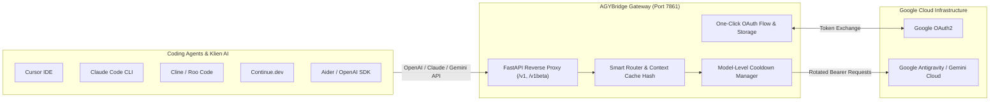

<p align="center">
  
</p>

<h1 align="center">AGYBridge Gateway</h1>

<p align="center">
  <strong>Universal High-Performance API Gateway for Google Antigravity</strong><br>
  <em>Menjembatani Google Antigravity ke dalam antarmuka standar OpenAI, Anthropic Claude, dan Google Gemini API.</em>
</p>

<p align="center">
  
  
  
  
  
  
</p>

---

## 🌟 Sekilas Fitur Unggulan

AGYBridge dirancang untuk mengubah akun Google Antigravity Anda menjadi endpoint API yang andal, aman, dan siap pakai untuk berbagai IDE, coding agent, dan aplikasi AI modern:

- 🚀 **One-Click Google OAuth Web Flow:** Hubungkan dan autentikasi akun Google langsung melalui browser dalam hitungan detik. Kredensial, Project ID, dan status langganan otomatis disimpan ke database SQLite tanpa repot download/upload JSON manual.
- 💻 **Preset Export Coding Agent Siap Pakai:** Integrasi instan dengan generator konfigurasi 1-klik untuk **Cursor**, **Claude Code CLI**, **Cline (VS Code)**, **Continue.dev**, dan **Aider**.
- 🔄 **Multi-Account Smart Balancing & Failover:** Rotasi otomatis antar banyak akun, load balancing dinamis, serta isolasi cooldown model saat menemui limit laju HTTP 429 tanpa melumpuhkan akun secara global.
- ⚡ **Optimasi Prompt Cache (Context Hash):** Mode perutean cerdas berbasis hash sesi obrolan (`cache`) yang memaksimalkan *prompt caching* upstream Google, memangkas latensi hingga 60%, dan menghemat kuota token.
- 🛡️ **Anti-Truncation (Penyambung Teks Otomatis):** Mencegah jawaban coding terpotong di tengah jalan pada output teks panjang dengan prefix `anti-truncate-`.
- 🧠 **Dukungan Reasoning / Thinking Tokens:** Streaming proses penalaran internal model secara real-time via Server-Sent Events (SSE).
- 🍖 **Integrasi Caveman Prompt:** Mode hemat token cerdas untuk respons ringkas, padat, dan hemat konteks.
- 📊 **Panel Kontrol Web Modern:** Antarmuka responsif (Inter & JetBrains Mono typography) dengan metrik real-time, log kuota token, filter status, dan konfigurasi fleksibel tanpa perlu restart server.

---

## 🏗️ Arsitektur Aliran Sistem



---

## 🎯 Model yang Didukung

AGYBridge secara otomatis memetakan dan menyediakan model-model unggulan:

| ID Model | Nama Model | Keunggulan Utama | Rekomendasi Penggunaan |
| :--- | :--- | :--- | :--- |
| `gemini-3.8-flash-high` | Gemini 3.8 Flash High | Kecepatan ultra tinggi, penalaran cerdas, efisien | **Default Utama** untuk Coding & Chat |
| `claude-sonnet-4-6` | Claude Sonnet 4.6 | Presisi sintaks coding luar biasa, refactoring mendalam | Autonomous coding di Cursor / Claude Code |
| `gemini-2.5-pro` | Gemini 2.5 Pro | Konteks raksasa, penalaran arsitektur rumit | Analisis codebase skala besar |
| `gemini-2.5-flash` | Gemini 2.5 Flash | Ringan, latensi sangat rendah | Autocomplete & quick queries |
| `anti-truncate-gemini-3.8-flash-high` | Anti-Truncate Gemini 3.8 | Melanjutkan respons panjang secara otomatis | Pembuatan file kode penuh tanpa terpotong |

---

## 💻 Panduan Integrasi Coding Agent

Buka tab **Preset Coding Agent** di panel web (`http://localhost:7861`) untuk menyalin atau mengunduh konfigurasi otomatis sesuai port dan API password Anda:

### 1. Cursor IDE
1. Buka **Cursor Settings** (`Ctrl/Cmd + Shift + J`) > **Models**.
2. Di bagian **OpenAI API Key**, masukkan kunci API Anda (default: `muharpolnep098`).
3. Aktifkan **Override OpenAI Base URL**, masukkan:
   ```text
   http://127.0.0.1:7861/v1
   ```
4. Tambahkan model kustom: `gemini-3.8-flash-high` atau `claude-sonnet-4-6`.
5. Simpan berkas `.cursorrules` di root proyek Anda melalui tombol **Unduh .cursorrules** di panel web.

### 2. Claude Code CLI
Jalankan di terminal proyek Anda sebelum memanggil CLI `claude`:
```bash
export ANTHROPIC_BASE_URL="http://127.0.0.1:7861/v1"
export ANTHROPIC_AUTH_TOKEN="muharpolnep098"
export CLAUDE_MODEL="claude-sonnet-4-6"

claude
```
*(Pengguna Windows PowerShell dapat menggunakan format `$env:ANTHROPIC_BASE_URL="http://127.0.0.1:7861/v1"`)*.

### 3. Cline / Roo Code (VS Code Extension)
- **API Provider:** `OpenAI-Compatible`
- **Base URL:** `http://127.0.0.1:7861/v1`
- **API Key:** Kata sandi API Anda (`muharpolnep098`)
- **Model ID:** `gemini-3.8-flash-high` atau `claude-sonnet-4-6`

### 4. Continue.dev
Tambahkan blok model ke berkas `~/.continue/config.json`:
```json
{
  "models": [
    {
      "title": "AGYBridge - Gemini 3.8",
      "provider": "openai",
      "model": "gemini-3.8-flash-high",
      "apiKey": "muharpolnep098",
      "apiBase": "http://127.0.0.1:7861/v1"
    },
    {
      "title": "AGYBridge - Claude Sonnet 4.6",
      "provider": "openai",
      "model": "claude-sonnet-4-6",
      "apiKey": "muharpolnep098",
      "apiBase": "http://127.0.0.1:7861/v1"
    }
  ]
}
```

### 5. Aider AI Pair Programming
```bash
aider --openai-api-base "http://127.0.0.1:7861/v1" \
      --openai-api-key "muharpolnep098" \
      --model "openai/gemini-3.8-flash-high"
```

---

## 🚀 Panduan Instalasi & Menjalankan

### Persyaratan Sistem
- Linux, macOS, atau Windows WSL
- Python 3.12 atau versi lebih baru
- `uv` (sangat direkomendasikan) atau `pip`
- `bun` (digunakan jika ingin mengompilasi ulang frontend)

### 1. Kloning & Persiapan Virtual Environment
```bash
git clone https://github.com/kyiov/agybridge.git agybridge
cd agybridge

# Buat virtual environment
uv venv
source .venv/bin/activate

# Pasang seluruh dependensi
uv sync
```

### 2. Konfigurasi Lingkungan (`.env`)
Salin atau buat berkas `.env` di folder root:
```env
PORT=7861
HOST=0.0.0.0
PANEL_PASSWORD=kata_sandi_panel_anda
API_PASSWORD=kata_sandi_api_anda
CREDENTIAL_SELECT_MODE=cache
USAGE_LOG_ENABLED=true
```

### 3. Menjalankan Layanan

#### Mode Development
```bash
source .venv/bin/activate
python web.py
```

#### Mode Background Produksi (PM2)
```bash
pm2 start /root/agybridge/.venv/bin/python3 --name "agybridge" -- web.py
pm2 save
```

Buka browser Anda di `http://127.0.0.1:7861` untuk mengakses Panel Kontrol.

---

## 📡 Contoh Pemanggilan API

### 1. Format OpenAI (`/v1/chat/completions`)
```bash
curl -X POST "http://localhost:7861/v1/chat/completions" \
  -H "Authorization: Bearer muharpolnep098" \
  -H "Content-Type: application/json" \
  -d '{
    "model": "gemini-3.8-flash-high",
    "messages": [
      {"role": "user", "content": "Halo! Jelaskan perbedaan arsitektur REST dan gRPC secara singkat."}
    ],
    "stream": false
  }'
```

### 2. Format Anthropic Claude (`/v1/messages`)
```bash
curl -X POST "http://localhost:7861/v1/messages" \
  -H "x-api-key: muharpolnep098" \
  -H "anthropic-version: 2023-06-01" \
  -H "Content-Type: application/json" \
  -d '{
    "model": "claude-sonnet-4-6",
    "max_tokens": 1024,
    "messages": [
      {"role": "user", "content": "Tuliskan implementasi algoritma merge sort dalam Python."}
    ]
  }'
```

### 3. Integrasi Python (OpenAI SDK Resmi)
```python
from openai import OpenAI

client = OpenAI(
    base_url="http://127.0.0.1:7861/v1",
    api_key="muharpolnep098"
)

response = client.chat.completions.create(
    model="gemini-3.8-flash-high",
    messages=[
        {"role": "user", "content": "Halo AGYBridge! Buat query SQL untuk rekapitulasi penjualan per bulan."}
    ]
)

print(response.choices[0].message.content)
```

---

## ⚙️ Tabel Referensi Konfigurasi

Semua konfigurasi dapat diubah melalui panel web pada tab **Pengaturan** atau melalui berkas `.env`:

| Variabel | Tipe | Standar | Deskripsi |
| :--- | :--- | :--- | :--- |
| `PORT` | Int | `7861` | Port HTTP yang didengarkan oleh server gateway |
| `HOST` | String | `0.0.0.0` | Binding alamat IP (gunakan `0.0.0.0` untuk semua antarmuka) |
| `API_PASSWORD` | String | `pwd` | Bearer token otorisasi pemanggilan endpoint API |
| `PANEL_PASSWORD` | String | `pwd` | Kata sandi masuk ke panel kontrol web |
| `CREDENTIAL_SELECT_MODE` | String | `cache` | Strategi rotasi akun (`cache`, `random`, `sticky`) |
| `IP_WHITELIST_ENABLED` | Bool | `false` | Batasi akses masuk hanya untuk IP terdaftar |
| `AUTO_BAN` | Bool | `false` | Otomatis menonaktifkan akun yang terkena error 403 |
| `RETRY_429_ENABLED` | Bool | `true` | Coba ulang otomatis saat menemui batas laju upstream |
| `RETRY_429_MAX_RETRIES` | Int | `3` | Jumlah maksimal percobaan pengulangan request |
| `RETRY_429_INTERVAL` | Int | `0` | Jeda waktu antar percobaan ulang (dalam detik) |
| `RETURN_THOUGHTS_TO_FRONTEND` | Bool | `true` | Kirim token penalaran (*thinking*) ke respons |
| `ANTI_TRUNCATION_MAX_ATTEMPTS` | Int | `3` | Maksimal pengulangan sambung otomatis pada respon terpotong |
| `USAGE_LOG_ENABLED` | Bool | `true` | Catat riwayat penggunaan token dan status ke SQLite |
| `PROXY` | String | `""` | Proksi keluar upstream (`http`, `https`, atau `socks5h`) |

---

## 🔒 Akses Remote & Tunneling

Layanan berjalan pada port lokal `7861`. Untuk akses remote aman:

### Opsi A: SSH Port Forwarding
```bash
ssh -L 7861:localhost:7861 user@ip_server_anda
```
Buka browser lokal di: `http://localhost:7861`

### Opsi B: Cloudflare Tunnel
```bash
cloudflared tunnel --url http://127.0.0.1:7861
```

---

## 💻 Pengembangan Frontend

Aplikasi antarmuka web berada pada direktori `frontend/`:
```bash
cd frontend
bun install     # Pasang dependensi
bun run dev     # Mode development dengan hot reload
bun run build   # Kompilasi aset produksi ke direktori dist/
```
Backend FastAPI secara mandiri menyajikan aset `dist/` tanpa memerlukan runtime Node.js tambahan saat produksi.

---

<sub>AGYBridge adalah fork mandiri yang dimodernisasi dari [agy2api](https://github.com/su-kaka/agy2api) dengan antarmuka baru berstandar Inter & JetBrains Mono, pembersihan kode, dan peningkatan performa gateway. Dilindungi lisensi [MIT](LICENSE) © 2026.</sub>
