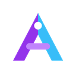

<div align="center">
  
  <h1>AGYBridge</h1>
  <p><strong>Universal API Gateway: Google Antigravity to OpenAI, Gemini & Claude Standards</strong></p>
  <p>High-performance proxy gateway featuring multi-account rotation, model-level cooldown isolation, intelligent prompt caching, and real-time observability.</p>
</div>

> [!NOTE]
> **AGYBridge** is an independently modernized fork of [agy2api](https://github.com/su-kaka/agy2api). It features a completely refactored codebase (zero non-standard character remnants), bilingual documentation, modernized dashboard typography (Inter & JetBrains Mono), and enhanced gateway stability.

---

## ⚡ Key Highlights

- **Standard Multi-Format API Support:**
  - `POST /v1/chat/completions` (OpenAI format)
  - `POST /v1beta/models/{model}:generateContent` (Gemini format)
  - `POST /v1/messages` (Claude format)
- **Multi-Account Credential Management:**
  - Round-robin load balancing and context-aware session pinning (`cache` mode).
  - Model-level HTTP 429 rate-limit cooldown isolation without taking down accounts globally.
- **Upstream Prompt Cache Optimization:**
  - Context-derived hashing pins conversations to identical credentials to maximize Google upstream prompt cache hits and reduce token overhead.
- **Anti-Truncation Engine:**
  - Automatically synthesizes continuation turns when response truncation is detected using the `anti-truncate-` model prefix.
- **Modern Web Control Panel:**
  - Built with React, Tailwind CSS, and Inter / JetBrains Mono typography for real-time credential management, usage analytics, error tracking, and zero-downtime configuration.
- **Native SSE Streaming:**
  - Fast Server-Sent Events with distinct separation of reasoning/thought tokens and output payload.

---

## 🚀 Getting Started

### Prerequisites
- Linux / macOS / Windows WSL
- Python >= 3.12
- Package manager: `uv` (recommended) or `pip`
- `bun` or `npm` (for frontend asset compilation)

### 1. Installation

```bash
# Clone the repository
git clone https://github.com/kyiov/agybridge.git agybridge
cd agybridge

# Create and activate virtual environment
uv venv
source .venv/bin/activate

# Install dependencies
uv sync
```

### 2. Configuration

Copy `.env.example` to `.env` and set your credentials:

```bash
cp .env.example .env
```

Key configuration variables:
```env
HOST=0.0.0.0
PORT=7861
PANEL_PASSWORD=your_secure_password
API_PASSWORD=your_secure_password
LOG_LEVEL=info
```

### 3. Launching the Service

```bash
python3 web.py
```

The service will be active at `http://127.0.0.1:7861/`.
- **Web Control Panel**: `http://127.0.0.1:7861/`
- **OpenAI Compatible Endpoint**: `http://127.0.0.1:7861/v1/chat/completions`
- **Gemini Compatible Endpoint**: `http://127.0.0.1:7861/v1beta/models`
- **Claude Compatible Endpoint**: `http://127.0.0.1:7861/v1/messages`

---

## 💻 API Usage Examples

### 1. cURL (OpenAI Compatible)

```bash
curl -X POST "http://127.0.0.1:7861/v1/chat/completions" \
  -H "Authorization: Bearer your_api_password" \
  -H "Content-Type: application/json" \
  -d '{
    "model": "gemini-3.8-flash",
    "messages": [
      {"role": "user", "content": "Explain quantum computing in one sentence."}
    ],
    "stream": false
  }'
```

### 2. Python (OpenAI SDK)

```python
from openai import OpenAI

client = OpenAI(
    api_key="your_api_password",
    base_url="http://127.0.0.1:7861/v1"
)

response = client.chat.completions.create(
    model="gemini-3.8-flash",
    messages=[
        {"role": "user", "content": "What is the capital of Indonesia?"}
    ]
)

print(response.choices[0].message.content)
```

---

## 🏗️ Building Frontend

The web dashboard assets are compiled into the `dist/` directory and served natively by the backend:

```bash
cd frontend
bun install
bun run build
```

---

## 🙏 Acknowledgements & Attribution

This project is built upon the foundational work of the open-source community:
- Originates from [`agy2api`](https://github.com/su-kaka/agy2api) created by [su-kaka](https://github.com/su-kaka).
- **AGYBridge** continues development as an independent, modernized downstream release focused on:
  - **Complete Localization & Clean Code:** Refactored codebase, zero non-standard character remnants, and comprehensive documentation in English and Indonesian.
  - **Overhauled UI & Typography:** Modernized React dashboard utilizing **Inter** and **JetBrains Mono** font hierarchy.
  - **Security & Cross-Platform Tooling:** Hardened secrets handling, updated cross-platform automation (Linux, macOS, Termux, Windows), and modern package toolchains.

Special thanks and appreciation to the original author and upstream contributors for their foundational work.

---

## 📜 License & Disclaimer

Distributed under the [MIT License](../LICENSE) © 2026 AGYBridge Contributors.

This project is created for educational, research, and API gateway benchmarking purposes. Ensure compliance with fair use policies and applicable upstream terms of service.
