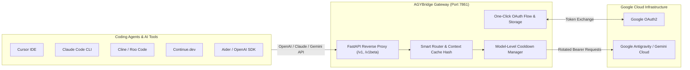

<div align="center">
  
  <h1>AGYBridge</h1>
  <p><strong>Universal API Gateway: Google Antigravity to OpenAI, Claude & Gemini Standards</strong></p>
  <p>High-performance proxy gateway featuring One-Click OAuth, Coding Agent Presets, multi-account rotation, model-level cooldown isolation, intelligent prompt caching, and real-time observability.</p>
</div>

<p align="center">
  
  
  
  
  
  
</p>

---

## ⚡ Key Highlights

- **🚀 One-Click Google OAuth Web Flow:** Connect Google Antigravity accounts instantly via browser popup. Credentials, tier levels (Free, Pro, Ultra), and project IDs are automatically verified and persisted into the database without manual JSON handling.
- **💻 Coding Agent Presets:** 1-Click ready-to-use configurations and file exports for **Cursor**, **Claude Code CLI**, **Cline (VS Code)**, **Continue.dev**, and **Aider**.
- **🔄 Multi-Account Smart Balancing:** Round-robin distribution, context-aware session pinning (`cache` mode), and model-level HTTP 429 cooldowns without taking accounts down globally.
- **⚡ Prompt Cache Optimization:** Context-derived hashing pins conversations to identical credentials to maximize upstream Google prompt caching, decreasing latency by up to 60%.
- **🛡️ Anti-Truncation Engine:** Automatically continues generation turns when long code responses hit token limits using the `anti-truncate-` prefix.
- **🧠 Thinking / Reasoning Tokens:** Real-time streaming of internal reasoning processes via Server-Sent Events (SSE).
- **🍖 Caveman Token Efficiency:** Integrated concise prompt mode for high token density and token conservation.
- **📊 Modern Web Control Panel:** Responsive UI built with React, Tailwind CSS, and Inter / JetBrains Mono typography for real-time monitoring and configuration without downtime.

---

## 🏗️ Architecture



---

## 🎯 Supported Models

| Model ID | Name | Strengths | Best For |
| :--- | :--- | :--- | :--- |
| `gemini-3.8-flash-high` | Gemini 3.8 Flash High | Ultra high speed, top-tier reasoning | **Primary Default** for general coding |
| `claude-sonnet-4-6` | Claude Sonnet 4.6 | Syntax accuracy, deep refactoring | Autonomous coding in Cursor / Claude Code |
| `gemini-2.5-pro` | Gemini 2.5 Pro | Massive context window, architecture reasoning | Large codebase comprehension |
| `gemini-2.5-flash` | Gemini 2.5 Flash | Lightweight, instant responsiveness | Autocomplete & quick queries |
| `anti-truncate-gemini-3.8-flash-high` | Anti-Truncate Gemini 3.8 | Auto-continues long responses | Complete file generation without cutoff |

---

## 💻 Coding Agent Integration

Visit the **Preset Coding Agent** tab in the web dashboard (`http://localhost:7861`) to export one-click configs:

### 1. Cursor IDE
- **Settings** (`Ctrl/Cmd + Shift + J`) > **Models** > **Override OpenAI Base URL**:
  ```text
  http://127.0.0.1:7861/v1
  ```
- **API Key**: Your API password (e.g. `muharpolnep098`)
- Download or copy `.cursorrules` directly from the dashboard.

### 2. Claude Code CLI
```bash
export ANTHROPIC_BASE_URL="http://127.0.0.1:7861/v1"
export ANTHROPIC_AUTH_TOKEN="muharpolnep098"
export CLAUDE_MODEL="claude-sonnet-4-6"

claude
```

### 3. Cline / Roo Code (VS Code)
- **API Provider:** `OpenAI-Compatible`
- **Base URL:** `http://127.0.0.1:7861/v1`
- **API Key:** `muharpolnep098`
- **Model ID:** `gemini-3.8-flash-high` or `claude-sonnet-4-6`

### 4. Continue.dev
In `~/.continue/config.json`:
```json
{
  "models": [
    {
      "title": "AGYBridge - Gemini 3.8",
      "provider": "openai",
      "model": "gemini-3.8-flash-high",
      "apiKey": "muharpolnep098",
      "apiBase": "http://127.0.0.1:7861/v1"
    }
  ]
}
```

---

## 🚀 Getting Started

### 1. Installation
```bash
git clone https://github.com/kyiov/agybridge.git agybridge
cd agybridge

uv venv
source .venv/bin/activate
uv sync
```

### 2. Configuration (`.env`)
```env
PORT=7861
HOST=0.0.0.0
PANEL_PASSWORD=your_panel_password
API_PASSWORD=your_api_password
CREDENTIAL_SELECT_MODE=cache
USAGE_LOG_ENABLED=true
```

### 3. Launching
```bash
# Direct run
python web.py

# Production with PM2
pm2 start /root/agybridge/.venv/bin/python3 --name "agybridge" -- web.py
pm2 save
```

Access the Web Control Panel at `http://127.0.0.1:7861/`.

---

## 📡 API Usage Examples

### cURL (OpenAI Compatible)
```bash
curl -X POST "http://localhost:7861/v1/chat/completions" \
  -H "Authorization: Bearer muharpolnep098" \
  -H "Content-Type: application/json" \
  -d '{
    "model": "gemini-3.8-flash-high",
    "messages": [
      {"role": "user", "content": "Explain microservices architecture briefly."}
    ]
  }'
```

### Python SDK
```python
from openai import OpenAI

client = OpenAI(
    base_url="http://127.0.0.1:7861/v1",
    api_key="muharpolnep098"
)

response = client.chat.completions.create(
    model="gemini-3.8-flash-high",
    messages=[{"role": "user", "content": "Hello AGYBridge!"}]
)

print(response.choices[0].message.content)
```

---

<sub>AGYBridge is an independently modernized fork of [agy2api](https://github.com/su-kaka/agy2api) with Inter & JetBrains Mono typography, clean codebase, and enhanced gateway performance. Distributed under the [MIT License](../LICENSE) © 2026.</sub>
